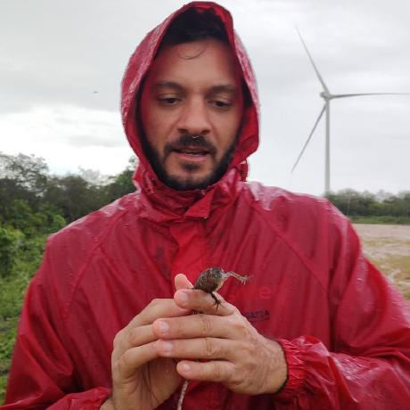

::: {.cc-cabeca}
[Quem faz]{.cc-chapeu}

# Um curioso contando o que falta sequenciar

[O traqueophyDNA é um projeto pessoal, aberto e mantido por uma pessoa. Correções e sugestões são muito bem-vindas.]{.cc-intro}
:::

::: {.cc-autor}
{fig-alt="Foto de Ricardo Silveira"}

::: {}
## Ricardo Silveira

[Ricardo Rodrigues da Silveira Filho · Natal, RN]{.cc-papel-autor}

Biólogo, doutor em Zoologia, hoje trabalhando com dados e software. Durante uma década, fez perguntas a dados biológicos em herpetologia, mimetismo, filogenética e filogeografia, principalmente de serpentes, e também em conservação, biodiversidade, bioinformática e ecologia vegetal.

No último trabalho, como Analista de Inovação na [Seteg](https://www.setegce.com/), consultoria ambiental, construiu sistemas usados pela empresa inteira e por clientes: softwares de gestão interna, aplicativos de coleta de dados em campo, análise de dados e relatórios, painéis de Business Intelligence e uma plataforma de gestão ESG. Também liderou o time de inovação, com três desenvolvedores e um designer.

::: {.cc-ctas}
[<i class="bi bi-envelope"></i> E-mail](mailto:rsilveirafh@gmail.com){.cc-cta .cc-pequeno}
[<i class="bi bi-mortarboard"></i> Lattes](http://lattes.cnpq.br/6028156427352678){.cc-cta .cc-pequeno}
[<i class="bi bi-github"></i> GitHub](https://github.com/rsilveirafh){.cc-cta .cc-pequeno}
[<i class="bi bi-linkedin"></i> LinkedIn](https://www.linkedin.com/in/rsilveirafh/){.cc-cta .cc-pequeno}
[<i class="bi bi-globe"></i> Site pessoal](https://rsilveirafh.netlify.app/){.cc-cta .cc-pequeno}
:::
:::
:::

## Trajetória

<ul class="cc-trajetoria">
<li>2025–2026Analista de Inovação, Seteg</li>
<li>2024–2025Analista Ambiental, Seteg</li>
<li>2022–2023Pós-doutorado na UFRN, junto ao PPBio: conservação, biodiversidade, bioinformática e genética</li>
<li>2020–2024Cientista de dados, Conciso TI</li>
<li>2018–2019Pós-doutorado na Universidade do Estado de Mato Grosso (UNEMAT): ecologia vegetal</li>
<li>2013–2017Doutorado em Zoologia, Universidade Federal da Paraíba (UFPB): filogeografia de <em>Philodryas nattereri</em></li>
<li>2011–Consultor ambiental e estatístico</li>
<li>2010–2012Mestrado em Zoologia, UFPB: mimetismo em serpentes corais</li>
<li>2008–2009Cadista, Barbosa & Barbosa</li>
<li>2004–2009Licenciatura em Ciências Biológicas, Universidade Estadual de Feira de Santana (UEFS)</li>
</ul>

## Contato

Escreva para [rsilveirafh@gmail.com](mailto:rsilveirafh@gmail.com). Achou uma espécie com situação errada, um sinônimo que faltou ou um nome desatualizado? [Abra uma correção no GitHub](https://github.com/rsilveirafh/traqueophyDNA/issues/new?labels=correcao). Para adotar uma espécie, veja [Adote uma espécie](adote.qmd). Para citar o painel, veja [Como citar](sobre.qmd#como-citar), em Método.
