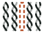



```{ojs}
//| output: false
n = conta(cobertura)
pct = v => fmtpct(v / n.total)
```

::: {.cc-capa}


# traqueophyDNA

[Quais anfíbios, répteis, aves e mamíferos do Brasil ainda não têm **nenhuma** sequência de DNA pública? Hoje são **${fmtn(n.sem)} espécies**, e outras ${fmtn(n.verificar)} precisam ter o nome conferido.]{.cc-lede}

::: {.cc-ctas}
[Ver espécies sem DNA](especies.qmd){.cc-cta .cc-principal}
[Adote uma espécie](adote.qmd){.cc-cta}
[Fontes e método](sobre.qmd){.cc-cta}
[<i class="bi bi-github"></i> Código](https://github.com/rsilveirafh/traqueophyDNA){.cc-cta}
:::
:::

```{ojs}
htl.html`<div class="cc-numeros">
  <div><span class="cc-num">${fmtn(n.total)}</span><span class="cc-rotulo">espécies nas listas</span></div>
  <div><span class="cc-num">${fmtn(n.com)}</span><span class="cc-rotulo"><b>${pct(n.com)}</b> com DNA público</span></div>
  <div><span class="cc-num">${fmtn(n.verificar)}</span><span class="cc-rotulo"><b>${pct(n.verificar)}</b> a verificar</span></div>
  <div class="cc-sem"><span class="cc-num">${fmtn(n.sem)}</span><span class="cc-rotulo"><b>${pct(n.sem)}</b> sem nenhum DNA</span></div>
</div>`
```

```{ojs}
htl.html`<p class="nota-pequena">Das ${fmtn(n.sem + n.verificar)} espécies sem sequência depositada,
  <b>${fmtn(n.brutos)}</b> já têm leituras brutas de sequenciamento no SRA que ninguém montou
  (<a href="especies.html">só dados brutos</a>).</p>`
```

[Atualizado em ${status.atualizado_em}, com dados do BOLD Systems, do GenBank e do SRA. Atualização automática toda semana.]{.nota-pequena}

::: {.cc-secao}
[O retrato]{.cc-chapeu}

## Cada quadradinho é uma espécie

[As ${fmtn(n.total)} espécies das listas oficiais das sociedades científicas, de anfíbios a mamíferos. Passe o mouse para ver o nome.]{.cc-intro}

```{ojs}
htl.html`<div class="cc-legenda">${SITUACOES.map((s, i) =>
  htl.html`<span style="--cor:${COR_SITUACAO[i]}">${s}</span>`)}</div>`
```

```{ojs}
{
  const ordem = new Map(SITUACOES.map((s, i) => [s, i]));
  const grupos = [...ROTULO_GRUPO.keys()];
  const dados = [...cobertura].sort((a, b) =>
    d3.ascending(ordem.get(a.situacao), ordem.get(b.situacao)) ||
    d3.ascending(grupos.indexOf(a.grupo), grupos.indexOf(b.grupo)) ||
    d3.ascending(a.especie, b.especie));
  const cols = width < 640 ? 50 : 100;
  const linhas = Math.ceil(dados.length / cols);
  const lado = width / cols;
  return Plot.plot({
    width, height: Math.ceil(linhas * lado), margin: 0, padding: 0.14,
    x: {axis: null, domain: d3.range(cols)},
    y: {axis: null, domain: d3.range(linhas)},
    color: {domain: SITUACOES, range: COR_SITUACAO},
    marks: [
      Plot.cell(dados.map((d, i) => ({...d, col: i % cols, lin: Math.floor(i / cols)})), {
        x: "col", y: "lin", fill: "situacao", rx: 1.5,
        tip: {fontFamily: "Inter, sans-serif"},
        title: d => `${d.especie}\n${d.grupo_rotulo} · ${d.familia}\n${d.situacao}`
      })
    ]
  });
}
```

[**Com DNA**: ao menos um registro público no BOLD ou no GenBank sob o nome da lista (ou sob uma combinação antiga do mesmo epíteto). **A verificar**: aparece sem DNA, mas há motivo para desconfiar do nome (DNA só sob outro nome, nome ausente do CTFB ou do GBIF, gênero muito sequenciado). **Sem DNA**: nada encontrado sob o nome e os sinônimos conhecidos. O painel conta sequências de DNA depositadas, de qualquer marcador; não é um levantamento de genomas nem de bases de referência para eDNA. Detalhes em [Fontes e método](sobre.qmd).]{.nota-pequena}
:::

::: {.cc-secao}
[Por grupo]{.cc-chapeu}

## Quatro listas, quatro lacunas

```{ojs}
{
  const img = {anfibios: "anfibios", repteis: "repteis", aves: "aves", mamiferos: "mamiferos"};
  const cartoes = [...ROTULO_GRUPO].map(([g, rot]) => {
    const c = conta(cobertura.filter(d => d.grupo === g));
    const barra = [["com", c.com], ["verificar", c.verificar], ["sem", c.sem]].map(([k, v], i) =>
      htl.html`<i style="width:${100 * v / c.total}%;background:${COR_SITUACAO[i]}"></i>`);
    return htl.html`<a class="cc-grupo" href="especies.html" style="color:inherit;text-decoration:none">
      <div class="cc-silhueta" role="img" aria-label="${rot}" style="mask-image:url(assets/silhuetas/${img[g]}.svg);-webkit-mask-image:url(assets/silhuetas/${img[g]}.svg)"></div>
      <h3>${rot}</h3>
      <span class="cc-total">${fmtn(c.total)} espécies</span>
      <div class="cc-barra">${barra}</div>
      <span class="cc-linha"><span>com DNA</span><b>${fmtpct(c.com / c.total)}</b></span>
      <span class="cc-linha"><span>a verificar</span><b>${fmtn(c.verificar)}</b></span>
      <span class="cc-linha cc-sem"><span>sem DNA</span><b>${fmtn(c.sem)}</b></span>
      <span class="cc-linha cc-brutos-linha"><span>só dados brutos</span><b>${fmtn(c.brutos)}</b></span>
    </a>`;
  });
  return htl.html`<div class="cc-grupos">${cartoes}</div>`;
}
```
:::

::: {.cc-secao}
[Onde estão]{.cc-chapeu}

## Famílias com mais espécies sem DNA

[Sem DNA e a verificar, somados. As quinze primeiras.]{.cc-intro}

```{ojs}
{
  const fam = d3.rollups(cobertura.filter(d => d.situacao !== "com DNA"),
    v => ({sem: v.filter(d => d.situacao === "sem DNA").length,
           verificar: v.filter(d => d.situacao === "a verificar").length, total: v.length,
           grupo: v[0].grupo_rotulo}),
    d => d.familia)
    .map(([familia, v]) => ({familia, ...v}))
    .sort((a, b) => d3.descending(a.total, b.total)).slice(0, 15);
  const linhas = fam.flatMap(f => [
    {familia: f.familia, grupo: f.grupo, situacao: "sem DNA", n: f.sem},
    {familia: f.familia, grupo: f.grupo, situacao: "a verificar", n: f.verificar}]);
  return Plot.plot({
    width: Math.min(width, 760), height: fam.length * 26 + 30, marginLeft: 140, marginRight: 40,
    style: {fontFamily: "Inter, sans-serif", fontSize: "13px"},
    x: {label: null, axis: "top", grid: true, tickFormat: fmtn},
    y: {label: null, domain: fam.map(d => d.familia), tickSize: 0},
    color: {domain: ["sem DNA", "a verificar"], range: [COR_SITUACAO[2], COR_SITUACAO[1]]},
    marks: [
      Plot.barX(linhas, Plot.stackX({x: "n", y: "familia", fill: "situacao",
        order: ["sem DNA", "a verificar"], inset: 1.5, rx: 2, tip: true,
        title: d => `${d.familia} (${d.grupo})\n${d.situacao}: ${fmtn(d.n)}`})),
      Plot.text(fam, {x: "total", y: "familia", text: d => fmtn(d.total), dx: 6, textAnchor: "start",
        fill: "currentColor", fillOpacity: 0.7}),
      Plot.ruleX([0])
    ]
  });
}
```

```{ojs}
htl.html`<div class="cc-legenda">
  <span style="--cor:${COR_SITUACAO[2]}">sem DNA</span>
  <span style="--cor:${COR_SITUACAO[1]}">a verificar</span></div>`
```
:::

::: {.cc-secao}
[Esquecidas]{.cc-chapeu}

## Descritas há mais tempo e ainda sem DNA

[Espécies conhecidas pela ciência há mais de um século e que nunca tiveram uma sequência depositada. Clique no nome para adotar.]{.cc-intro}

```{ojs}
{
  const velhas = cobertura.filter(d => d.situacao === "sem DNA" && d.ano_descricao)
    .sort((a, b) => d3.ascending(a.ano_descricao, b.ano_descricao)).slice(0, 12);
  return htl.html`<ul class="cc-antigas">${velhas.map(d => htl.html`<li>
    <span class="cc-ano">${d.ano_descricao}</span>
    <span class="cc-quem"><a href="${link_adote(d.especie)}" target="_blank" title="Quero sequenciar"><em>${d.especie}</em></a>
      <small>${d.grupo_rotulo} · ${d.familia}${d.categoria_ameaca ? ` · ${d.categoria_ameaca}` : ""}</small></span>
  </li>`)}</ul>`;
}
```
:::

::: {.cc-secao}
[Novidades]{.cc-chapeu}

## Espécies que ganharam DNA

```{ojs}
{
  const ev = await FileAttachment("data/eventos.csv").csv({typed: true});
  if (!ev.length) return md`Nenhuma ainda. A cada atualização semanal, toda espécie que sair da lista "sem DNA" aparece aqui.`;
  return htl.html`<ul class="cc-antigas">${ev.reverse().slice(0, 12).map(d => htl.html`<li>
    <span class="cc-ano" style="color:var(--cc-mata)">${String(d.data).slice(0, 10)}</span>
    <span class="cc-quem"><em>${d.especie}</em><small>${ROTULO_GRUPO.get(d.grupo) ?? d.grupo}</small></span>
  </li>`)}</ul>`;
}
```
:::

::: {.cc-faixa}
## Adote uma espécie

Tem tecido de uma dessas espécies na coleção do seu laboratório? Diga em público que vai sequenciá-la: evita esforço duplicado e ajuda a achar parceiros.

[Como adotar](adote.qmd){.cc-cta .cc-principal}
:::
